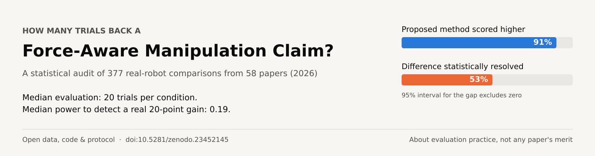

# How Many Trials Back a Force-Aware Manipulation Claim?

Data, code and protocol for a statistical audit of real-robot evaluations in 2026 force-, torque-, tactile- and
motor-current-aware robot manipulation papers.

**Author:** Clement Aidoo (CANLABS) · ORCID [0009-0005-6893-2677](https://orcid.org/0009-0005-6893-2677) · clement.aidoo@canlabs.org  
**Archived data and code:** [doi:10.5281/zenodo.23452145](https://doi.org/10.5281/zenodo.23452145) (v2.0; v1.0 is [doi:10.5281/zenodo.23442248](https://doi.org/10.5281/zenodo.23442248))  
**Paper:** engrXiv preprint (link added on publication)

## Headline results (v2)

- 89 arXiv papers screened, 58 included, 377 binary real-robot comparisons extracted (337 primary).
- Median condition evaluated on 20 trials; 17% of papers report any interval on success, 5% any significance test.
- The proposed method scores higher in 91% of comparisons, but the 95% interval for the difference excludes zero in 53%.
- Only 6% of comparisons had 80% power to detect a true 20-point improvement (median power 0.19).

## What is here

| Path | Contents |
|---|---|
| `PROTOCOL.md` | Pre-specified protocol and every dated deviation (D1–D10) |
| `data/extract/` | One JSON record per screened paper, with sources and notes |
| `verify/` | Blinded second extraction, agreement statistics, adjudication log |
| `human/` | Author's blinded hand re-check of a seeded 20% sample, hash-locked sheets, resolutions |
| `stats.py`, `tests/` | Statistical functions (Wilson, Newcombe, Fisher, Boschloo, Holm, exact power, simulations) and unit tests |
| `analyze.py` | Runs analyses A1–A7 and writes `results/` |
| `make_figures.py`, `make_tables.py` | Figures and tables for the paper |
| `paper/` | LaTeX source and PDF; every number is read from generated macro files |
| `assets/` | README banner, generated from `results/summary.json` by `make_banner.py` |
| `authors/` | Per-paper confirmation sheets for the papers' authors |

## Reproduce

```
pip install numpy scipy matplotlib openpyxl pytest
python3 -m pytest tests
python3 analyze.py          # about 3 minutes
python3 make_figures.py && python3 make_tables.py
cd paper && pdflatex main.tex && pdflatex main.tex
```

The git history is part of the record: commit timestamps show the protocol and each deviation were committed
before they were applied.
On 2026-10-18 the commit author fields in this repository were set to the author and tool trailers were removed;
commit dates and contents are unchanged. The original, unmodified history is preserved inside both Zenodo archives.
As the paper discloses, extraction, verification, adjudication and analysis code were produced with AI assistance
under the author's direction. The audit concerns evaluation practice across the field, not the merit of any paper.

## Licence

CC BY 4.0. Please cite the Zenodo record.
